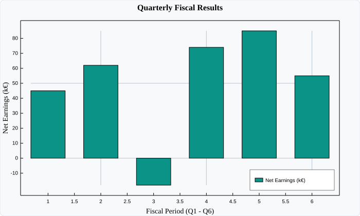

# BarChart (Column & Bar Charts)

`BarChart` renders categorical and discrete numeric distributions as vertical columns. Bars project outward from the zero baseline ($Y = 0$), natively supporting both **positive earnings** and **negative deficits** (e.g. the Q3 operating loss projecting downward below the axis).

---

## Visual Preview



---

## Code Examples

### ⚛️ React (TSX)

```tsx
import React from 'react';
import { Display, BarChart } from 'luminy-react';

export const FinancialBarChart: React.FC = () => {
  // 6 fiscal quarters; Q3 reflects an operating deficit (-18k€) projecting below zero
  const quarters = [1, 2, 3, 4, 5, 6];
  const netEarnings = [45, 62, -18, 74, 85, 55];

  return (
    <Display
      width={700}
      height={420}
      title="Quarterly Fiscal Results"
      xLabel="Fiscal Period (Q1 - Q6)"
      yLabel="Net Earnings (k€)"
      showGrid={true}
      showLegend={true}
      legendPosition="BottomRight"
    >
      <BarChart
        x={quarters}
        heights={netEarnings}
        barWidth={0.65}
        color="#0d9488"
        label="Net Earnings (k€)"
      />
    </Display>
  );
};
```

### 🔷 C# (.NET Core)

```csharp
using Luminy.Builders;
using Luminy.Model;

var luminy = new LuminyBuilder { Width = 700, Height = 420 };

// 6 fiscal quarters; Q3 accounts for an operating loss (-18k€)
float[] quarters = [1f, 2f, 3f, 4f, 5f, 6f];
float[] earnings = [45f, 62f, -18f, 74f, 85f, 55f];

var bars = luminy.Bars(quarters, earnings, label: "Net Earnings (k€)", color: new Color(0.05f, 0.58f, 0.53f), barWidth: 0.65f);

var display = luminy.Display(bars) with
{
    Title = "Quarterly Fiscal Results",
    XLabel = "Fiscal Period (Q1 - Q6)",
    YLabel = "Net Earnings (k€)",
    ShowGrid = true,
    ShowLegend = true,
    LegendPosition = LegendPosition.BottomRight,
    AxesStyle = AxesStyle.Frame
};

string svg = display.ToSvg();
```

### 🪟 WPF (XAML / C#)

```xaml
<luminy:Display
    PlotTitle="Quarterly Fiscal Results"
    XAxisLabel="Fiscal Period (Q1 - Q6)"
    YAxisLabel="Net Earnings (k€)"
    ShowGrid="True"
    ShowLegend="True"
    LegendPosition="BottomRight"
    Width="700"
    Height="420">
    <luminy:BarChart
        XValues="{Binding Quarters}"
        Heights="{Binding NetEarnings}"
        BarWidth="0.65"
        Fill="#0d9488"
        Label="Net Earnings (k€)" />
</luminy:Display>
```

---

## Parameters & Props Reference

| Parameter / Prop | React (`BarChartProps`) | C# (`BarChart`) | WPF (`BarChart`) | Description |
| :--- | :--- | :--- | :--- | :--- |
| **Heights** | `heights: number[]` | `float[] Heights` | `Heights` (`IEnumerable<double>`) | Bar magnitudes relative to $Y=0$ |
| **X Centers** | `x?: number[]` | `float[]? X` | `XValues` (`IEnumerable<double>`) | Central coordinate for each bar |
| **Bar Width** | `barWidth?: number` | `float? BarWidth` | `BarWidth` (`double`) | Width of each bar in data units |
| **Bar Color** | `color?: string` | `Color Color` | `Fill` (`Brush`) | Color fill of the bars |
| **Label** | `label?: string` | `string Label` | `Label` (`string`) | Legend series identifier |
