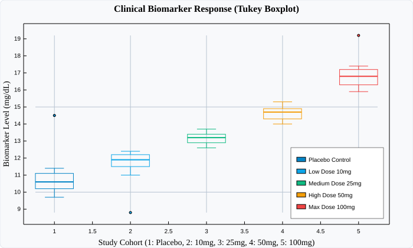

# BoxPlot (Tukey Box & Whisker Plots)

`BoxPlot` provides a compact five-number statistical summary of continuous data distributions using the standard **Tukey box-and-whisker** representation.

---

## Visual Preview



---

## Code Examples

### ⚛️ React (TSX)

```tsx
import React from 'react';
import { Display, BoxPlot } from 'luminy-react';

export const ClinicalTrialBoxPlot: React.FC = () => {
  const control = [10.2, 10.8, 11.1, 9.7, 10.5, 11.4, 10.3, 9.9, 10.6, 14.5]; // 14.5 is outlier
  const dose10 = [11.5, 11.9, 12.2, 11.0, 12.4, 11.8, 12.1, 11.6, 12.3, 8.8];   // 8.8 is outlier
  const dose25 = [12.8, 13.4, 13.1, 12.6, 13.7, 13.2, 13.5, 12.9, 13.3, 13.0];
  const dose50 = [14.2, 14.9, 14.5, 14.0, 15.1, 14.6, 14.8, 14.3, 15.3, 14.7];
  const dose100 = [16.0, 16.8, 16.5, 15.9, 17.2, 16.6, 17.0, 16.3, 17.4, 19.2]; // 19.2 is outlier

  return (
    <Display
      width={700}
      height={420}
      title="Clinical Biomarker Response (Tukey Boxplot)"
      xLabel="Study Cohort (1: Placebo, 2: 10mg, 3: 25mg, 4: 50mg, 5: 100mg)"
      yLabel="Biomarker Level (mg/dL)"
      showGrid={true}
      showLegend={true}
      legendPosition="BottomRight"
    >
      <BoxPlot data={control} x={1} width={0.5} color="#0284c7" label="Placebo Control" />
      <BoxPlot data={dose10} x={2} width={0.5} color="#0ea5e9" label="Low Dose 10mg" />
      <BoxPlot data={dose25} x={3} width={0.5} color="#10b981" label="Medium Dose 25mg" />
      <BoxPlot data={dose50} x={4} width={0.5} color="#f59e0b" label="High Dose 50mg" />
      <BoxPlot data={dose100} x={5} width={0.5} color="#ef4444" label="Max Dose 100mg" />
    </Display>
  );
};
```

### 🔷 C# (.NET Core)

```csharp
using Luminy.Builders;
using Luminy.Model;

var luminy = new LuminyBuilder { Width = 700, Height = 420 };

float[] control = [10.2f, 10.8f, 11.1f, 9.7f, 10.5f, 11.4f, 10.3f, 9.9f, 10.6f, 14.5f];
float[] dose10 = [11.5f, 11.9f, 12.2f, 11.0f, 12.4f, 11.8f, 12.1f, 11.6f, 12.3f, 8.8f];
float[] dose25 = [12.8f, 13.4f, 13.1f, 12.6f, 13.7f, 13.2f, 13.5f, 12.9f, 13.3f, 13.0f];
float[] dose50 = [14.2f, 14.9f, 14.5f, 14.0f, 15.1f, 14.6f, 14.8f, 14.3f, 15.3f, 14.7f];
float[] dose100 = [16.0f, 16.8f, 16.5f, 15.9f, 17.2f, 16.6f, 17.0f, 16.3f, 17.4f, 19.2f];

var box1 = luminy.Box(control, x: 1f, label: "Placebo Control", color: new Color(0.01f, 0.52f, 0.78f), width: 0.5f);
var box2 = luminy.Box(dose10, x: 2f, label: "Low Dose 10mg", color: new Color(0.05f, 0.65f, 0.91f), width: 0.5f);
var box3 = luminy.Box(dose25, x: 3f, label: "Medium Dose 25mg", color: new Color(0.06f, 0.73f, 0.51f), width: 0.5f);
var box4 = luminy.Box(dose50, x: 4f, label: "High Dose 50mg", color: new Color(0.96f, 0.62f, 0.04f), width: 0.5f);
var box5 = luminy.Box(dose100, x: 5f, label: "Max Dose 100mg", color: new Color(0.94f, 0.27f, 0.27f), width: 0.5f);

var display = luminy.Display(box1, box2, box3, box4, box5) with
{
    Title = "Clinical Biomarker Response (Tukey Boxplot)",
    XLabel = "Study Cohort (1: Placebo, 2: 10mg, 3: 25mg, 4: 50mg, 5: 100mg)",
    YLabel = "Biomarker Level (mg/dL)",
    ShowGrid = true,
    ShowLegend = true,
    LegendPosition = LegendPosition.BottomRight,
    AxesStyle = AxesStyle.Frame
};

string svg = display.ToSvg();
```

### 🪟 WPF (XAML / C#)

```xaml
<luminy:Display
    PlotTitle="Clinical Biomarker Response (Tukey Boxplot)"
    XAxisLabel="Study Cohort"
    YAxisLabel="Biomarker Level (mg/dL)"
    ShowGrid="True"
    ShowLegend="True"
    LegendPosition="BottomRight"
    Width="700"
    Height="420">
    <luminy:BoxPlot
        Data="{Binding ControlData}"
        XPosition="1"
        BoxWidth="0.5"
        Stroke="#0284c7"
        Label="Placebo Control" />
    <luminy:BoxPlot
        Data="{Binding Dose10Data}"
        XPosition="2"
        BoxWidth="0.5"
        Stroke="#0ea5e9"
        Label="Low Dose 10mg" />
    <luminy:BoxPlot
        Data="{Binding Dose25Data}"
        XPosition="3"
        BoxWidth="0.5"
        Stroke="#10b981"
        Label="Medium Dose 25mg" />
    <luminy:BoxPlot
        Data="{Binding Dose50Data}"
        XPosition="4"
        BoxWidth="0.5"
        Stroke="#f59e0b"
        Label="High Dose 50mg" />
    <luminy:BoxPlot
        Data="{Binding Dose100Data}"
        XPosition="5"
        BoxWidth="0.5"
        Stroke="#ef4444"
        Label="Max Dose 100mg" />
</luminy:Display>
```

---

## Parameters & Props Reference

| Parameter / Prop | React (`BoxPlotProps`) | C# (`BoxPlot`) | WPF (`BoxPlot`) | Description |
| :--- | :--- | :--- | :--- | :--- |
| **Data Points** | `data: number[]` | `float[] Data` | `Data` (`IEnumerable<double>`) | Sample data points to summarize |
| **X Center** | `x?: number` | `float X = 1f` | `XPosition` (`double`) | Horizontal position of the box |
| **Box Width** | `width?: number` | `float Width = 0.8f` | `BoxWidth` (`double`) | Box width in coordinate units |
| **Stroke Color** | `color?: string` | `Color Color` | `Stroke` (`Brush`) | Color of box, median, and whiskers |
| **Fill Color** | `fill?: string` | — | `Fill` (`Brush`) | Interior fill of the quartile box |
| **Outlier Size** | `outlierRadius?: number` | — | `OutlierRadius` (`double`) | Radius of individual outlier circles |
| **Label** | `label?: string` | `string Label` | `Label` (`string`) | Legend series identifier |
