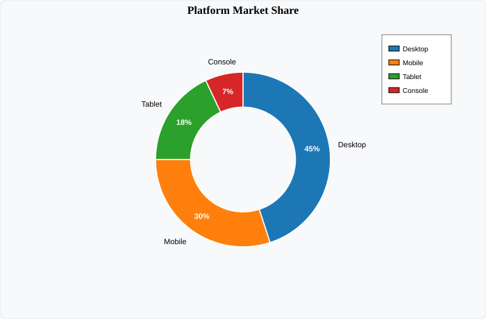

# DonutPlot (Donut & Pie Charts)

`DonutPlot` visualizes categorical proportions and percentages in radial coordinates. It dynamically supports both **full pie charts** (`internalRadius = 0`) and **donut charts** (`internalRadius > 0`).

---

## Visual Preview



---

## Code Examples

### ⚛️ React (TSX)

```tsx
import React from 'react';
import { Display, DonutPlot } from 'luminy-react';

export const MarketShareChart: React.FC = () => {
  const values = [45, 30, 18, 7];
  const labels = ['Desktop', 'Mobile', 'Tablet', 'Console'];

  return (
    <Display
      width={700}
      height={460}
      title="Platform Market Share"
      axesStyle="none"
      showGrid={false}
      showLegend={true}
    >
      <DonutPlot
        values={values}
        labels={labels}
        externalRadius={1.0}
        internalRadius={0.6}
        insideValueDisplay="percent"
        showSliceLabels={true}
        minInsideValueThreshold={0.05}
      />
    </Display>
  );
};
```

### 🔷 C# (.NET Core)

```csharp
using Luminy.Builders;
using Luminy.Model;

var luminy = new LuminyBuilder();
var values = new[] { 45f, 30f, 18f, 7f };
var labels = new[] { "Desktop", "Mobile", "Tablet", "Console" };

var display = luminy.DonutDisplay(
    values,
    labels,
    title: "Platform Market Share",
    internalRadius: 0.6f,
    externalRadius: 1.0f,
    insideValueDisplay: DonutValueDisplay.Percent,
    showSliceLabels: true
) with
{
    Width = 700,
    Height = 460
};

string svg = display.ToSvg();
```

### 🪟 WPF (XAML / C#)

```xaml
<luminy:Display
    PlotTitle="Platform Market Share"
    AxesStyle="None"
    ShowGrid="False"
    ShowLegend="True"
    Width="700"
    Height="460">
    <luminy:DonutPlot
        Values="{Binding MarketValues}"
        Labels="{Binding MarketLabels}"
        InternalRadius="0.6"
        ExternalRadius="1.0"
        InsideValueDisplay="Percent"
        ShowSliceLabels="True" />
</luminy:Display>
```

---

## Parameters & Props Reference

| Parameter / Prop | React (`DonutPlotProps`) | C# (`DonutPlot`) | WPF (`DonutPlot`) | Description |
| :--- | :--- | :--- | :--- | :--- |
| **Values** | `values: number[]` | `float[] Values` | `Values` (`IEnumerable<double>`) | Slice magnitudes/proportions |
| **Labels** | `labels?: string[]` | `string[]? Labels` | `Labels` (`IEnumerable<string>`) | Category label for each slice |
| **Colors** | `colors?: string[]` | `Color[]? Colors` | `Colors` (`IEnumerable<Brush>`) | Custom slice colors palette |
| **Internal Radius** | `internalRadius?: number` | `float InternalRadius = 0.6f` | `InternalRadius` (`double`) | Inner hole radius (`0.0` for solid pie) |
| **External Radius** | `externalRadius?: number` | `float ExternalRadius = 1.0f` | `ExternalRadius` (`double`) | Outer radius of the donut |
| **Inside Display** | `insideValueDisplay?: 'percent' \| 'raw' \| 'none'` | `InsideValueDisplay` | `InsideValueDisplay` | Format of text rendered inside slices |
| **Outside Labels** | `showSliceLabels?: boolean` | `bool ShowSliceLabels = true` | `ShowSliceLabels` (`bool`) | Render labels at 110% external radius |
| **Threshold** | `minInsideValueThreshold?: number` | `float MinInsideValueThreshold = 0.05f` | `MinInsideValueThreshold` (`double`) | Suppresses inside text on small slices |
