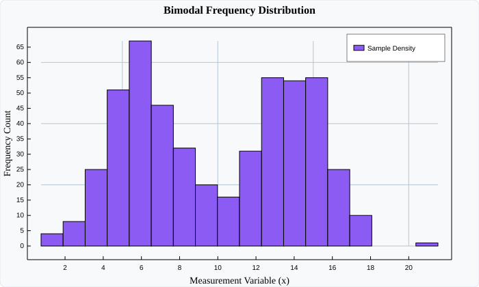

# HistogramPlot (Frequency Distributions)

`HistogramPlot` computes and renders the frequency distribution of continuous numerical data. It automatically discretizes sample points into $k$ contiguous bins and draws proportional frequency rectangles.

---

## Visual Preview



---

## Code Examples

### ⚛️ React (TSX)

```tsx
import React from 'react';
import { Display, HistogramPlot } from 'luminy-react';

export const SampleHistogram: React.FC = () => {
  const samples = 500;
  const data: number[] = [];

  for (let i = 0; i < samples; i++) {
    const u1 = Math.max(1e-6, Math.abs((Math.sin(i * 12.9898 + 5) * 43758.5453) % 1));
    const u2 = ((Math.sin(i * 78.233 + 11) * 43758.5453) % 1 + 1) % 1;
    const r = Math.sqrt(-2.0 * Math.log(u1));
    const theta = 2.0 * Math.PI * u2;
    const z0 = r * Math.cos(theta);
    const center = (i % 2 === 0) ? 6.0 : 14.0;
    data.push(center + z0 * 1.8);
  }

  return (
    <Display
      width={700}
      height={420}
      title="Bimodal Frequency Distribution"
      xLabel="Measurement Variable (x)"
      yLabel="Frequency Count"
      showGrid={true}
      showLegend={true}
      axesStyle="Frame"
    >
      <HistogramPlot
        data={data}
        binCount={18}
        color="#8b5cf6"
        stroke="rgba(255, 255, 255, 0.3)"
        label="Sample Density"
      />
    </Display>
  );
};
```

### 🔷 C# (.NET Core)

```csharp
using System;
using Luminy.Builders;
using Luminy.Model;

var luminy = new LuminyBuilder { Width = 700, Height = 420 };

const int samples = 500;
var data = new float[samples];
for (var i = 0; i < samples; i++)
{
    var u1 = Math.Max(1e-6f, Math.Abs((MathF.Sin(i * 12.9898f + 5f) * 43758.5453f) % 1f));
    var u2 = (MathF.Sin(i * 78.233f + 11f) * 43758.5453f) % 1f;
    var r = MathF.Sqrt(-2.0f * MathF.Log(u1));
    var theta = 2.0f * MathF.PI * u2;
    var z0 = r * MathF.Cos(theta);

    var center = (i % 2 == 0) ? 6.0f : 14.0f;
    data[i] = center + z0 * 1.8f;
}

var hist = luminy.Histogram(data, binCount: 18, label: "Sample Density", color: new Color(0.55f, 0.36f, 0.96f));

var display = luminy.Display(hist) with
{
    Title = "Bimodal Frequency Distribution",
    XLabel = "Measurement Variable (x)",
    YLabel = "Frequency Count",
    ShowGrid = true,
    ShowLegend = true,
    AxesStyle = AxesStyle.Frame
};

string svg = display.ToSvg();
```

### 🪟 WPF (XAML / C#)

```xaml
<luminy:Display
    PlotTitle="Bimodal Frequency Distribution"
    XAxisLabel="Measurement Variable (x)"
    YAxisLabel="Frequency Count"
    ShowGrid="True"
    ShowLegend="True"
    Width="700"
    Height="420">
    <luminy:HistogramPlot
        Data="{Binding SampleData}"
        BinCount="18"
        Fill="#8b5cf6"
        Label="Sample Density" />
</luminy:Display>
```

---

## Parameters & Props Reference

| Parameter / Prop | React (`HistogramPlotProps`) | C# (`HistogramPlot`) | WPF (`HistogramPlot`) | Description |
| :--- | :--- | :--- | :--- | :--- |
| **Data Array** | `data: number[]` | `float[] Data` | `Data` (`IEnumerable<double>`) | Continuous raw numerical values |
| **Bin Count** | `binCount?: number` | `int BinCount` | `BinCount` (`int`) | Number of equal-width intervals |
| **Fill Color** | `color?: string` | `Color Color` | `Fill` (`Brush`) | Bar fill color |
| **Bin Stroke** | `stroke?: string` | — | `Stroke` (`Brush`) | Color of bin separation borders |
| **Border Width** | `strokeWidth?: number` | — | `StrokeThickness` (`double`) | Border thickness between bins |
| **Label** | `label?: string` | `string Label` | `Label` (`string`) | Legend series identifier |
