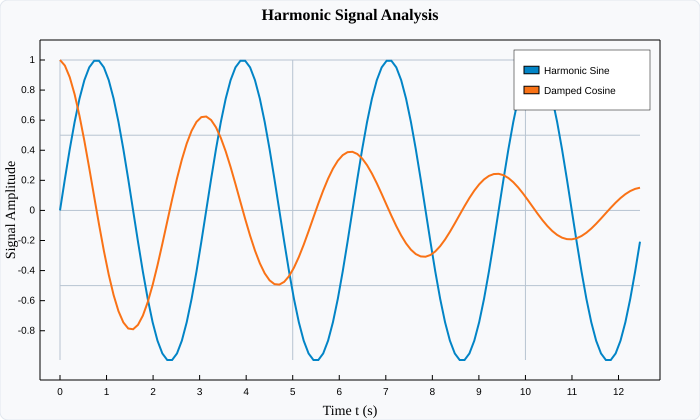

# LinePlot

`LinePlot` renders continuous 2D curves by connecting ordered coordinate points $(x_i, y_i)$ with vector paths. It is the core primitive for time series, mathematical functions, physical oscillations, and scientific measurements.

---

## Visual Preview



---

## Code Examples

### ⚛️ React (TSX)

```tsx
import React from 'react';
import { Display, LinePlot } from 'luminy-react';

export const SignalChart: React.FC = () => {
  const x = [0, 1, 2, 3, 4, 5, 6];
  const y = [0, 0.84, 0.91, 0.14, -0.76, -0.96, -0.28];

  return (
    <Display width={700} height={420} title="Harmonic Wave" showGrid={true} showLegend={true}>
      <LinePlot
        x={x}
        y={y}
        label="Sine Output"
        color="#0284c7"
        strokeWidth={2.5}
      />
      <LinePlot
        x={x}
        y={y.map(v => v * 0.5)}
        label="Damped Phase"
        color="#f97316"
        strokeWidth={1.5}
        strokeDasharray="4 4"
      />
    </Display>
  );
};
```

### 🔷 C# (.NET Core)

```csharp
using Luminy.Builders;
using Luminy.Model;

float[] x = [0, 1, 2, 3, 4, 5, 6];
float[] y = [0, 0.84f, 0.91f, 0.14f, -0.76f, -0.96f, -0.28f];

var display = LuminyBuilder.Chart()
    .WithDimensions(700, 420)
    .WithTitle("Harmonic Wave")
    .WithGrid()
    .Add(new LinePlot(x, y, "Sine Output", Color.FromHex("#0284c7"), StrokeWidth: 2.5f))
    .Build();

string svg = display.ToSvg();
```

### 🪟 WPF (XAML / C#)

```xaml
<luminy:Display
    PlotTitle="Harmonic Wave"
    ShowGrid="True"
    ShowLegend="True"
    Width="700"
    Height="420">
    <luminy:LinePlot
        XValues="{Binding TimeData}"
        YValues="{Binding SineData}"
        Stroke="#0284c7"
        StrokeThickness="2.5" />
</luminy:Display>
```

---

## Parameters & Props Reference

| Parameter / Prop | React (`LinePlotProps`) | C# (`LinePlot`) | WPF (`LinePlot`) | Description |
| :--- | :--- | :--- | :--- | :--- |
| **X Data** | `x: number[]` | `float[] X` | `XValues` (`IEnumerable<double>`) | Abscissa coordinate points |
| **Y Data** | `y: number[]` | `float[] Y` | `YValues` (`IEnumerable<double>`) | Ordinate coordinate points |
| **Label** | `label?: string` | `string Label` | `Label` (`string`) | Legend label identifier |
| **Stroke Color** | `color?: string` | `Color Color` | `Stroke` (`Brush`) | Path stroke color |
| **Stroke Width** | `strokeWidth?: number` | `float StrokeWidth` | `StrokeThickness` (`double`) | Thickness of the path curve |
| **Dash Pattern** | `strokeDasharray?: string` | — | `StrokeDashArray` (`DoubleCollection`) | Dashed or dotted line pattern |
