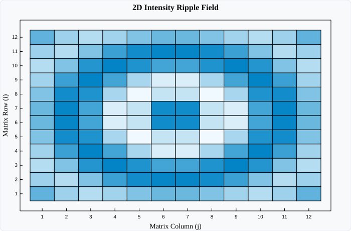

# MatrixPlot (2D Heatmaps)

`MatrixPlot` renders a 2D numerical array ($M \times N$) as a color-coded heatmap. Cell values are dynamically normalized to the range $[0.0, 1.0]$ and interpolated between configurable minimum and maximum colors.

---

## Visual Preview



---

## Code Examples

### ⚛️ React (TSX)

```tsx
import React from 'react';
import { Display, MatrixPlot } from 'luminy-react';

export const HeatmapDemo: React.FC = () => {
  // 3x3 2D numerical array
  const matrix = [
    [1.0, 2.5, 3.8],
    [4.2, 5.0, 2.1],
    [0.5, 1.8, 4.9]
  ];

  return (
    <Display
      width={700}
      height={460}
      title="Thermal Intensity Field"
      xLabel="Spatial Column Index"
      yLabel="Spatial Row Index"
      showGrid={false}
      showLegend={false}
    >
      <MatrixPlot
        data={matrix}
        colorMin="#f0f9ff"
        colorMax="#0284c7"
        cellStroke="rgba(255, 255, 255, 0.4)"
        cellStrokeWidth={0.5}
        label="Intensity"
      />
    </Display>
  );
};
```

### 🔷 C# (.NET Core)

```csharp
using Luminy.Builders;
using Luminy.Model;

float[,] matrix = {
    { 1.0f, 2.5f, 3.8f },
    { 4.2f, 5.0f, 2.1f },
    { 0.5f, 1.8f, 4.9f }
};

var display = LuminyBuilder.Chart()
    .WithDimensions(700, 460)
    .WithTitle("Thermal Intensity Field")
    .Add(new MatrixPlot(
        matrix,
        ColorMin: Color.FromHex("#f0f9ff"),
        ColorMax: Color.FromHex("#0284c7"),
        Label: "Intensity"
    ))
    .Build();

string svg = display.ToSvg();
```

### 🪟 WPF (XAML / C#)

```xaml
<luminy:Display
    PlotTitle="Thermal Intensity Field"
    XAxisLabel="Column"
    YAxisLabel="Row"
    Width="700"
    Height="460">
    <luminy:MatrixPlot
        Data2D="{Binding HeatmapMatrix}"
        ColorMin="#f0f9ff"
        ColorMax="#0284c7"
        CellStroke="White"
        CellStrokeThickness="0.5" />
</luminy:Display>
```

---

## Parameters & Props Reference

| Parameter / Prop | React (`MatrixPlotProps`) | C# (`MatrixPlot`) | WPF (`MatrixPlot`) | Description |
| :--- | :--- | :--- | :--- | :--- |
| **2D Data** | `data: number[][]` | `float[,] Data` | `Data2D` (`double[,]`) | 2D matrix array |
| **Minimum Color** | `colorMin?: string` | `Color ColorMin` | `ColorMin` (`Color`) | Color mapped to the minimum value |
| **Maximum Color** | `colorMax?: string` | `Color ColorMax` | `ColorMax` (`Color`) | Color mapped to the maximum value |
| **Cell Border** | `cellStroke?: string` | — | `CellStroke` (`Brush`) | Border line color separating cells |
| **Border Width** | `cellStrokeWidth?: number` | — | `CellStrokeThickness` (`double`) | Cell border stroke thickness |
| **Label** | `label?: string` | `string Label` | `Label` (`string`) | Legend series identifier |
