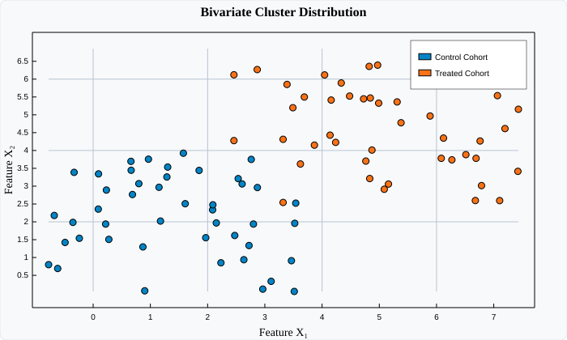

# PointPlot (Scatter Plots)

`PointPlot` renders discrete mathematical coordinates $(x_i, y_i)$ as circular markers. It is the primary tool for scatter diagrams, clustering analyses, bivariate correlations, and non-continuous point distributions.

---

## Visual Preview



---

## Code Examples

### ⚛️ React (TSX)

```tsx
import React from 'react';
import { Display, PointPlot } from 'luminy-react';

export const ScatterDemo: React.FC = () => {
  const count = 45;
  const xA: number[] = [], yA: number[] = [];
  const xB: number[] = [], yB: number[] = [];

  for (let i = 0; i < count; i++) {
    const u1 = ((Math.sin(i * 12.9898 + 1) * 43758.5453) % 1 + 1) % 1;
    const u2 = ((Math.sin(i * 78.233 + 2) * 43758.5453) % 1 + 1) % 1;
    xA.push(2.5 + (u1 - 0.5) * 2.2);
    yA.push(3.0 + (u2 - 0.5) * 2.0);

    const u3 = ((Math.sin((i + 100) * 12.9898 + 3) * 43758.5453) % 1 + 1) % 1;
    const u4 = ((Math.sin((i + 100) * 78.233 + 4) * 43758.5453) % 1 + 1) % 1;
    xB.push(6.2 + (u3 - 0.5) * 2.5);
    yB.push(5.8 + (u4 - 0.5) * 2.2);
  }

  return (
    <Display
      width={700}
      height={420}
      title="Bivariate Cluster Distribution"
      xLabel="Feature X₁"
      yLabel="Feature X₂"
      showGrid={true}
      showLegend={true}
      axesStyle="Frame"
    >
      <PointPlot
        x={xA}
        y={yA}
        pointSize={4}
        color="#0284c7"
        label="Control Cohort"
      />
      <PointPlot
        x={xB}
        y={yB}
        pointSize={4}
        color="#f97316"
        label="Treated Cohort"
      />
    </Display>
  );
};
```

### 🔷 C# (.NET Core)

```csharp
using System;
using Luminy.Builders;
using Luminy.Model;

var luminy = new LuminyBuilder { Width = 700, Height = 420 };

const int count = 45;
var xA = new float[count];
var yA = new float[count];
var xB = new float[count];
var yB = new float[count];

for (var i = 0; i < count; i++)
{
    var u1 = (MathF.Sin(i * 12.9898f + 1f) * 43758.5453f) % 1f;
    var u2 = (MathF.Sin(i * 78.233f + 2f) * 43758.5453f) % 1f;
    xA[i] = 2.5f + (u1 - 0.5f) * 2.2f;
    yA[i] = 3.0f + (u2 - 0.5f) * 2.0f;

    var u3 = (MathF.Sin((i + 100) * 12.9898f + 3f) * 43758.5453f) % 1f;
    var u4 = (MathF.Sin((i + 100) * 78.233f + 4f) * 43758.5453f) % 1f;
    xB[i] = 6.2f + (u3 - 0.5f) * 2.5f;
    yB[i] = 5.8f + (u4 - 0.5f) * 2.2f;
}

var pointsA = luminy.Points(xA, yA, label: "Control Cohort", color: new Color(0.01f, 0.52f, 0.78f), pointSize: 4);
var pointsB = luminy.Points(xB, yB, label: "Treated Cohort", color: new Color(0.98f, 0.45f, 0.09f), pointSize: 4);

var display = luminy.Display(pointsA, pointsB) with
{
    Title = "Bivariate Cluster Distribution",
    XLabel = "Feature X₁",
    YLabel = "Feature X₂",
    ShowGrid = true,
    ShowLegend = true,
    AxesStyle = AxesStyle.Frame
};

string svg = display.ToSvg();
```

### 🪟 WPF (XAML / C#)

```xaml
<luminy:Display
    PlotTitle="Bivariate Cluster Distribution"
    XAxisLabel="Feature X₁"
    YAxisLabel="Feature X₂"
    ShowGrid="True"
    ShowLegend="True"
    Width="700"
    Height="420">
    <luminy:PointPlot
        XValues="{Binding ControlX}"
        YValues="{Binding ControlY}"
        PointSize="4"
        Fill="#0284c7"
        Label="Control Cohort" />
    <luminy:PointPlot
        XValues="{Binding TreatedX}"
        YValues="{Binding TreatedY}"
        PointSize="4"
        Fill="#f97316"
        Label="Treated Cohort" />
</luminy:Display>
```

---

## Parameters & Props Reference

| Parameter / Prop | React (`PointPlotProps`) | C# (`PointPlot`) | WPF (`PointPlot`) | Description |
| :--- | :--- | :--- | :--- | :--- |
| **X Coordinates** | `x: number[]` | `float[] X` | `XValues` (`IEnumerable<double>`) | Abscissa values |
| **Y Coordinates** | `y: number[]` | `float[] Y` | `YValues` (`IEnumerable<double>`) | Ordinate values |
| **Point Radius** | `pointSize?: number` | `float PointSize = 3.5f` | `PointSize` (`double`) | Marker radius in viewport pixels |
| **Marker Color** | `color?: string` | `Color Color` | `Fill` (`Brush`) | Point fill color |
| **Label** | `label?: string` | `string Label` | `Label` (`string`) | Legend series identifier |
