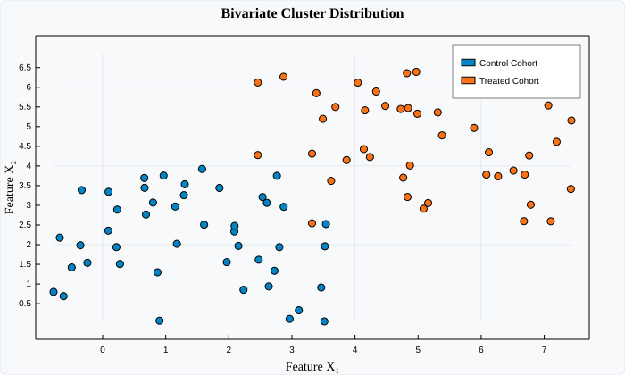

# PointPlot (Scatter Plots)

`PointPlot` renders discrete mathematical coordinates $(x_i, y_i)$ as circular markers. It is the primary tool for scatter diagrams, clustering analyses, bivariate correlations, and non-continuous point distributions.

---

## Visual Preview



---

## Code Examples

### ⚛️ React (TSX)

```tsx
import React from 'react';
import { Display, PointPlot } from 'luminy-react';

export const ScatterDemo: React.FC = () => {
  const xControl = [1.2, 1.8, 2.3, 2.9, 1.5, 2.1];
  const yControl = [3.1, 3.5, 3.0, 3.8, 3.4, 2.9];

  const xTreated = [4.5, 5.1, 5.8, 6.2, 4.9, 5.4];
  const yTreated = [5.2, 5.9, 6.1, 5.7, 6.3, 5.5];

  return (
    <Display width={700} height={420} title="Bivariate Clustering" showGrid={true} showLegend={true}>
      <PointPlot
        x={xControl}
        y={yControl}
        pointSize={4}
        color="#0284c7"
        label="Control Group"
      />
      <PointPlot
        x={xTreated}
        y={yTreated}
        pointSize={4}
        color="#f97316"
        label="Treated Cohort"
      />
    </Display>
  );
};
```

### 🔷 C# (.NET Core)

```csharp
using Luminy.Builders;
using Luminy.Model;

float[] x = [1.2f, 1.8f, 2.3f, 2.9f, 1.5f, 2.1f];
float[] y = [3.1f, 3.5f, 3.0f, 3.8f, 3.4f, 2.9f];

var display = LuminyBuilder.Chart()
    .WithDimensions(700, 420)
    .WithTitle("Bivariate Clustering")
    .WithGrid()
    .Add(new PointPlot(x, y, "Control Group", Color.FromHex("#0284c7"), PointSize: 4f))
    .Build();

string svg = display.ToSvg();
```

### 🪟 WPF (XAML / C#)

```xaml
<luminy:Display
    PlotTitle="Bivariate Clustering"
    ShowGrid="True"
    ShowLegend="True"
    Width="700"
    Height="420">
    <luminy:PointPlot
        XValues="{Binding ControlX}"
        YValues="{Binding ControlY}"
        PointSize="4"
        Fill="#0284c7"
        Label="Control Group" />
</luminy:Display>
```

---

## Parameters & Props Reference

| Parameter / Prop | React (`PointPlotProps`) | C# (`PointPlot`) | WPF (`PointPlot`) | Description |
| :--- | :--- | :--- | :--- | :--- |
| **X Coordinates** | `x: number[]` | `float[] X` | `XValues` (`IEnumerable<double>`) | Abscissa values |
| **Y Coordinates** | `y: number[]` | `float[] Y` | `YValues` (`IEnumerable<double>`) | Ordinate values |
| **Point Radius** | `pointSize?: number` | `float PointSize = 3.5f` | `PointSize` (`double`) | Marker radius in viewport pixels |
| **Marker Color** | `color?: string` | `Color Color` | `Fill` (`Brush`) | Point fill color |
| **Label** | `label?: string` | `string Label` | `Label` (`string`) | Legend series identifier |
